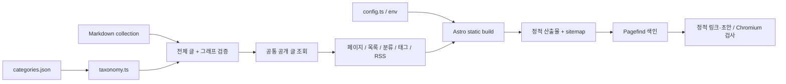

# 현재 아키텍처

## 목적·제약과 신뢰 경계

한국어 개인 보안·CTF·컴퓨터공학·프로젝트 기록을 위한 정적 블로그다. Fuwari 원본 Astro/Svelte/Tailwind UI를 확장한다. 출처는 `docs/provenance.md`, 블로그 기능 계약은 `specs/personal-blog/spec.md`, CMS 계약은 `specs/pages-cms/spec.md`가 기준이다. 방문자는 빌드된 HTML·CSS·JS·이미지만 받으며 방문자용 인증·DB·업로드 서버는 없다. 작성자는 GitHub 권한으로 hosted Pages CMS에서 저장소 글·분류·이미지를 편집할 수 있는 신뢰된 사람이다. CMS의 인증·GitHub App·저장소 권한은 외부 서비스 경계이며 Markdown·설정·이미지는 코드와 동일한 빌드 신뢰 경계에 있다. 현재는 GitHub 저장소가 없어 이 외부 연결을 실행하지 않았다.

도구는 Docker Linux에서만 실행한다. 소스는 Windows bind mount, 의존성과 캐시는 named volume이다. 이미지·도구 버전과 lockfile은 Dockerfile·package.json·pnpm-lock.yaml이 기준이다. 앱은 비루트 `node` 사용자다. CI/Linux에서는 빌드 인자 BLOG_UID/BLOG_GID로 bind workspace의 소유자와 컨테이너 UID/GID를 맞춘다. 개발 서버의 호스트 공개는 127.0.0.1:4321로 제한한다.

## 모듈과 흐름

- `src/data/categories.json`: 모든 분류 정의의 유일한 기준. 표시명과 안정적 ASCII ID, parentId, 순서를 갖는다.
- `src/utils/taxonomy.ts`: 순수 그래프 검증, Map/Set 인덱스, 조상·자손·고유 공개 글 집계와 태그 중복 제거. Astro·UI에 의존하지 않는다.
- `src/utils/content-utils.ts`: 전체 content collection을 먼저 검증하고 이후 항상 초안을 제외한다. 정렬과 이전/다음, 분류·태그 목록이 같은 공개 경계를 사용한다. 개발에서도 초안을 노출하지 않는다.
- `src/utils/base-path.ts`와 `url-utils.ts`: base 없는 논리 경로에 base를 붙인다. 이미 base를 포함하는 Astro pagination URL은 다시 helper에 넣지 않는다. 저장소 이름 `posts`처럼 논리 경로와 충돌하는 base도 허용한다.
- `src/plugins/remark-base-urls.mjs`: Markdown의 사이트 루트 링크·이미지에 base를 붙인다. RSS는 별도 MarkdownIt 처리 과정에서 공개 root 이미지를 절대 URL로 바꾸고 글 폴더의 상대 이미지를 Vite `?url` 산출물에 연결한다.
- `src/components/widget/CategoryBranch.astro`, `Categories.astro`: 재귀 목록, 실제 hidden disclosure, aria-expanded/controls, 현재 위치와 조상 열기를 제공한다. 일반 nav/list와 네이티브 버튼을 사용한다. 시각적 들여쓰기는 제한하지만 논리 깊이는 제한하지 않는다.
- `src/pages/categories/[id].astro`: 해당 노드와 모든 자손의 고유 공개 글을 표시한다. 이름이나 부모를 바꿔도 `/categories/<id>/` 주소를 유지한다.
- 원본의 MainGridLayout·PostCard·Profile·Pagefind·목차·Expressive Code·PhotoSwipe·테마를 재사용한다. Swup은 `main`, `#toc`, `#sidebar`를 함께 교체하여 이동·뒤로가기에서도 분류 선택이 최신 상태가 된다. 커스텀 엘리먼트의 connectedCallback이 새 목록에 이벤트를 연결한다.
- 페이지 이동은 @swup/astro 1.8.0의 `animationClass: false`, `theme: false`로 애니메이션 대기를 끄고 onload fade/slide·stagger CSS와 클래스를 제거한다. `smoothScrolling: false`로 자동 ScrollPlugin을 끄고 Layout에서 기존 공개 client export의 ScrollPlugin을 한 번만 추가하고 `animateScroll`의 세 옵션을 모두 false로 설정한다. `animateHistoryBrowsing: true`는 plugin의 manual 위치 복원을 활성화한다. animationClass가 false이고 페이지 CSS 연출도 없어 내용 교체 자체에는 fade/등장 연출이 없다. native history 복원만 사용하면 더 짧은 기존 DOM에서 y400이 y297로 제한되는 실제 회귀가 있어 교체 후 캐시 좌표를 복원하는 plugin을 유지한다. 아래쪽 일반 링크는 목적지 응답이 준비된 뒤 content:replace before hook에서 기존 scrollTo(0,true)와 scroll:end를 기다려 old DOM을 상단으로 이동하고 교체한다. 원래 위치는 visit:start에서 먼저 캐시되며 상향 스크롤이 시작된 방문의 종료까지 공개 skipPopStateHandling 옵션과 link:click replacement로 처리 대상 후속 입력 하나만 보류한다. 기존 skip 판정과 링크 기본 handler를 보존하고 새 입력이 이전 보류 입력을 대체한다. visit:end에서 버퍼를 먼저 비운 뒤 마지막 링크 handler 또는 Swup 상태의 popstate 이벤트를 한 번 실행하고 core 대기열에 넘긴다. 이로써 core가 동일 URL Forward를 무시해 앞선 Back만 남기는 경쟁과 history index 불일치를 피한다. 실패·abort·disable에서 보류 상태를 비우고 disable에서는 원래 skip 판정을 복원한다. 새탭·수정키와 core가 먼저 무시하는 동일 목적지 중복클릭은 기존 동작이다. 실제 링크/nonhash/nonpopstate/reset/y>1/!reduced-motion만 적용하고 상단·history·hash·모션 줄이기는 기존 즉시 처리다. 완료/휠 취소 listener는 finally에서 해제하고 임의 timer·수제 RAF·private scroller API는 사용하지 않는다. 기본 scroll 플래그를 그대로 두어 취소 시 post-swap top과 manual 복원을 보존한다. cache/preload/head/accessibility와 세 교체 대상은 유지한다. 전환용 임시 높이·TOC 준비 숨김·종료 지연은 없고 배너 홈 레이아웃은 content:replace에서 갱신한다. TOC는 animationend 대신 연결 시 초기화하고 해제 시 capture listener도 제거한다. 메뉴·분류 펼침·호버·복사·테마와 사용자가 누른 맨 위로/목차 위치 안내는 기존 피드백을 유지한다.
- `src/styles/global.css`: 원본 공통 클래스와 Markdown의 @apply를 한 Tailwind 처리 단위로 합친다. Layout은 원본 Stylus 변수·Markdown 확장도 불러온다. 가져온 commit의 빈 GlobalStyles에 의존하지 않는다. ImageWrapper의 동적 import glob은 이미지 확장자로만 제한하여 CSS가 독립 이미지 모듈처럼 처리되지 않게 한다.

## 데이터와 주소 결정

이름 기반 URL은 동명 충돌과 개명 시 링크 변경이 생기므로 안정적인 ID 경로를 선택했다. 부모 경로를 URL에 포함하지 않아 트리 이동도 주소를 바꾸지 않는다. Breadcrumb는 실제 부모 참조를 따른다. 글은 단일 categoryId를 가지며 부모 노드에도 직접 게시할 수 있다. 부모 개수는 자식 표시 개수의 합이 아니라 실제 자손 글 ID 집합의 크기다. 중복 태그는 글당 한 번만 집계한다.

`draft: true`는 글을 원문 저장소에서 숨기는 기능이 아니다. 직접 정적 경로가 생성되지 않고 모든 공개 목록·인접 글·검색 색인·피드·sitemap에서 제외되는 발행 경계다. 저장소가 공개라면 원문은 읽힐 수 있다. 배포 대상은 정적 output 디렉터리뿐이다.

기존 아카이브는 `ArchivePanel`을 `client:only="svelte"`로 렌더하고 클라이언트 초기화에서 태그를 처리한다. 모듈을 처음 불러올 때 교체 후 실제 글 목록 렌더가 늦어 잠시 빈 main이 나타날 수 있다. 전환 검사의 첫 프레임 opacity/transform 확인은 교체 container의 CSS 가시성만 입증하며 client-only 콘텐츠의 첫 렌더 완료를 보장하지 않는다. 이 제약은 READ-04 viewport 스크롤 수정과 별개로 남아 있고, SSR/태그 route 변경은 구현하지 않았다.

글 컬렉션은 `src/utils/tags-schema.ts`의 공용 tags 스키마를 사용한다. Astro5의 Zod3는 유지하되 초과 태그 배열을 preprocess에서 원소 파싱 전에 중단한다. source preflight는 텍스트 파일을 읽기 전 용량을 확인하고 check/dev/build/verify와 독립 감사에서 실행한다. 감사의 별도 입력 경계 guard는 실제 스키마 probe, 승인된 스키마 연결·입력 경로와 검사 배선을 검증한다. 구체적인 한도·거부 조건과 Zod 미패치/YAML·도구 내부 경로 등의 한계는 security-spec의 SEC-CONTENT-02가 기준이다. serialize-javascript는7.1.3 패치를 고정한다. 원시 감사 보고서와 정책 pending/failed/passed 상태는 분리 저장한다.

모바일 PostCard cover는 기존20vh 상한과 같은 높이를 미리 예약한다. public 이미지의 intrinsic 크기가 늦게 준비되면 높이0→200px이 되면서 복원된 y1162가1362로 이동하는 실제 경쟁을 확인했다. `h-[20vh] md:h-auto`로 모바일 공간만 예약하고 데스크톱 absolute 배치를 유지한다. 이미지 미완료·완료 시점 모두 원래 history 좌표를 유지하는 응답 gate 회귀로 검증한다.

Profile의 avatar anchor도 aspect-square로 기존 정사각 공간을 예약한다. 이미지 완료 전 높이0이면 모바일 전체 최대 스크롤이168px 줄어 y1943 복원이1775로 제한되고, 이미지 완료 후에도 복원이 회복되지 않는 별도 원인을 확인했다. cover와 avatar 응답을 함께 보류한 상태와 완료 후를 모두 검사하며 임의 좌표 보정이나 전역 scroll anchoring 해제는 하지 않는다.

## Pages CMS 편집 흐름과 결정

`src/data/categories.json`의 top-level 배열이 분류의 유일한 기준이다. Pages CMS reference는 collection의 개별 파일을 참조하므로 배열 행을 참조할 수 없다. `scripts/lib/cms.mjs`는 기존 taxonomy 검증을 재사용해 안정적인 ID/전체 조상 경로를 static select로 생성하고 `scripts/cms-config.mjs`가 `.pages.yml`을 기록/검사한다. JSON 표기법의 유효한 YAML로 직렬화하며 `--check`는 결정적 출력의 차이를 실패시킨다. 파일을 분리해 분류를 이중 관리하지 않는다.

CMS는 글 collection의 필드와 Markdown rich-text(Editor/Source), JSON file/list 카테고리 필드를 명시한다. 기존 메타데이터는 merge 설정으로 보존한다. 새 글은 draft=true, 생성 파일명은 `{fields.slug}.md`이고 rename UI는 차단한다. 기존 slug는 편집 가능한 필드이므로 작성자가 유지해야 한다. 날짜는 `content-date.ts`에서 Date 또는 유효한 YYYY-MM-DD만 정규화하며 필수 published와 빈 선택 updated를 구분한다. 부모 없음의 null/빈 문자열은 taxonomy 내부에서 undefined로 정규화하고 원본 배열은 변경하지 않는다.

분류 저장 → 명시적 선택지 갱신 → CMS 다시 열기가 필요하다. `.github/workflows/cms-actions.yml`은 main만 허용하고 실제 GitHub repository/ref와 payload source/action/repository/ref를 대조한다. event 파일 하나를 Docker에 readonly mount하며 입력 JSON을 runner env/로그에 복사하지 않는다. 갱신 job은 Docker 생성·검사·build 뒤 `.pages.yml`만 일반 commit/push하고 verify를 publish=false로 명시 요청한다. 동시 main 변경이나 보호된 branch의 거부는 실패하며 강제 덮어쓰지 않는다. 게시 action은 기존 verify.yml을 publish=true로 명시 요청하고 검증 통과/main 조건을 유지한다. 갱신 job만 contents:write/actions:write, 게시 요청은 actions:write이고 실제 pages/id-token 권한은 기존 deploy job에만 있다.

CMS 미디어는 `public/images`→`/images`, PNG/JPG/JPEG/WebP/GIF만 받는다. SVG/AVIF는 CMS 업로드 허용 목록에서 제외한다. 기존 검토된 로컬 SVG와 trusted source 검사는 유지한다. 실제 hosted 저장/업로드/Editor 변환/action 실행은 아직 검증하지 않았고 온보딩·남은 수동 인수 검사는 README에 있다. 합성 저장 형식 fixture는 실제 CMS roundtrip으로 간주하지 않는다.

Astro devToolbar는 설정으로 비활성화한다. dev와 build가 content store를 공유하므로 동시 실행하지 않는다.

## 실행·배포와 검증

`pnpm verify`가 명령 실행기이고 실제 수정 반복은 개발자가 수행한다. 읽기 전용 Biome 검사, Astro/콘텐츠 타입, Node 단위 테스트, source/security audit 정책 검사, `/`·`/blog/`·`/posts/` 세 base의 생산 빌드와 산출물 검사, 두 base의 Chromium 브라우저 검사를 순서대로 실행한다. 필수 단계 실패·도구 누락·감사 응답 오류는 비영 종료다.

브라우저 검사는 Docker에 설치한 Playwright Chromium에서 실제 Pagefind 색인·카테고리 disclosure·Swup·뒤로가기·검색·목차·코드 복사·테마·모바일을 확인하고 스크린샷을 남긴다. 정적 검사에서는 HTML href/src/srcset, canonical·RSS alternate·robots·sitemap·피드 이미지와 초안 canary를 확인한다.

GitHub CI도 Docker Compose에서 같은 verify를 실행하고 저장소별 origin/base로 실제 Pages artifact를 다시 빌드한다. 수동 workflow_dispatch 게시를 설정할 수 있으나 이 작업에서는 실행하지 않는다. 실제 저장소 설정·Git hook·브랜치 보호·배포 상태는 로컬 설정 파일의 존재로 확인되지 않는다.

## 로그·운영

정적 서비스의 방문 로그나 개인정보 수집을 추가하지 않는다. verify 실행기는 UTC 시각, level, event, module, jobId를 JSON으로 출력한다. 단계 시작은 고정 명령과 단계명을, 종료·실패는 종료 코드·소요 시간·결과를 기록한다. 자식 도구 stdout/stderr를 함께 제공하여 같은 작업 ID의 마지막 성공 단계와 실패 지점을 찾는다. 임의 사용자 명령·환경 전체·토큰·본문은 기록하지 않는다.

INFO는 시작·정상 결과, ERROR는 실패, dependency audit의 알려진 잔여 위험은 WARN이다. DEBUG 장기 로깅은 없으며 추가 도구 진단은 단일 실행에서만 활성화 후 제거한다. Compose 서비스 로그는 json-file 10MB×3개 순환으로 제한한다. ephemeral run 출력의 별도 저장은 사용자 선택이다. 로컬 진단 자료는 문제 해결 후 정리하고 CI evidence는 7일 보관한다. 접근은 Docker/저장소 권한을 따르며 로그 쓰기·도구 실행 오류는 통과로 변환하지 않는다. 실제 조회 명령은 README가 기준이다.

## 알려진 위험·기술 부채

Astro5의 legacy content API와 기존 Fuwari 통합을 유지했다. 호환 major 패치와 Sharp/serialize-javascript override로 다수 취약 의존성을 갱신했으나 원시 audit에는 알려진 advisory가 남는다. 상세 적용 조건·완화와 새 advisory 실패 정책은 security-spec이 기준이다. 신뢰되지 않은 Markdown·이미지·CSS·glob 입력, SSR adapter, 서버 island·인증을 도입하면 현재 위험 검토를 재수행해야 한다. Astro7 전환은 별도 마이그레이션·회귀 검사가 필요하다.

Windows 개발 watcher는 300ms polling으로 src/public 변경을 감지한다. 생성물 세 output·artifacts와 docs/specs·의존성·Git 디렉터리는 명시적으로 제외한다. `.astro/`는 Astro data-store 감지와 경로 캐시 무효화에 필요하므로 계속 관찰한다. 무제한 프로젝트 polling과 native watcher의 A/B 진단에서 초기 SSR 요청의 장기 대기와 CPU 부하가 발견되어 관찰 범위를 제한했다. 실제 페이지 응답과 새 public 파일의 생성/삭제 반영을 함께 확인하며, 정적 파일 응답만으로 앱 정상 상태를 판단하지 않는다.

